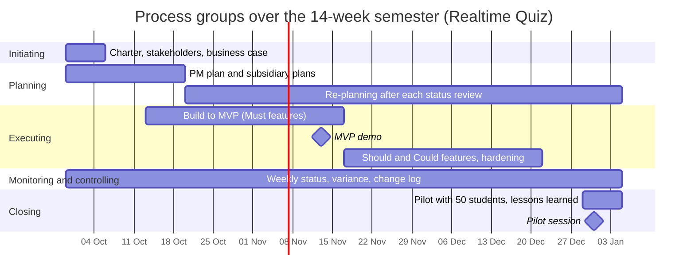

# Process groups over the semester

| Process group | Weeks active | Main activities | Outputs | Lab that produces them |
|---------------|--------------|-----------------|---------|------------------------|
| Initiating | 1 (re-checked at each gate) | write the charter, identify stakeholders, justify the investment | project charter, stakeholder list, business case | Lab-01 |
| Planning | 1-3 first burst, then re-planning weeks 4-14 | scope, schedule, cost and risk planning; re-plan after each status review | PM plan and subsidiary plans, baselines, updated plans | Labs 02-08 |
| Executing | 3-12 | build to the MVP, then Should and Could features, hardening and the load test | working increments, MVP demo, tested release, runbook | every build phase of the project |
| Monitoring and controlling | 1-14 | weekly status meeting, schedule and cost variance, risk review, change requests | status reports, change log, updated baselines | Labs 05, 06, 09 (tools), every lab (practice) |
| Closing | 14 | pilot with 50 students, hand-over to IT operations, lessons learned | pilot report, runbook handed over, lessons learned | final lab |

## Process groups over the semester

## Phase gates
At each gate the sponsor decides to continue, change or stop, based on evidence (PRINCE2's continued business justification).
- Week 1, charter approval: the charter is signed by the sponsor and the business case shows payback within two academic years.
- Week 7, MVP demo: all Must features pass live in front of the sponsor; if the demo fails, the business case says to switch to option B (buy a SaaS) for next semester.
- Week 13, pilot readiness: the load test at 100 simulated students is green, data approval from the data protection officer is received, and the runbook is handed to IT operations.
